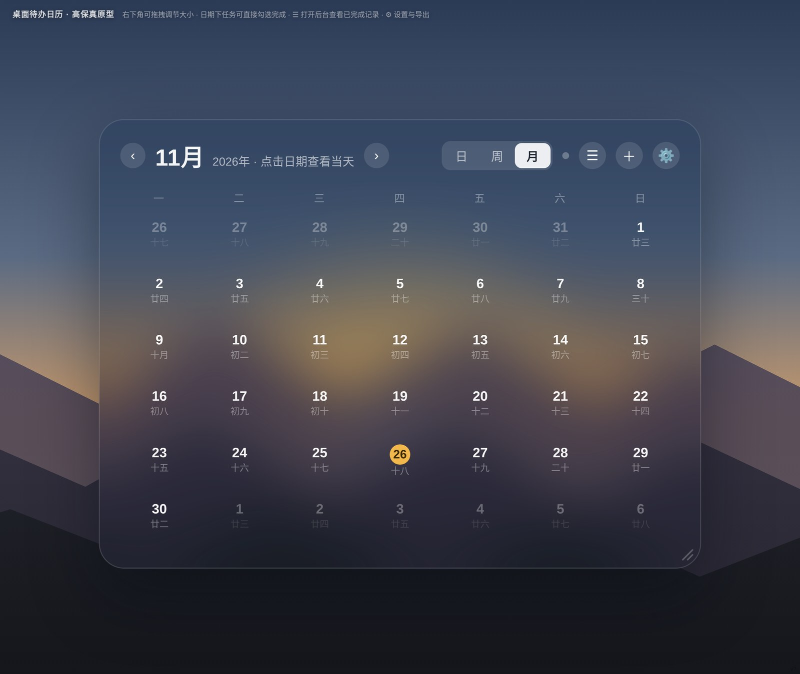
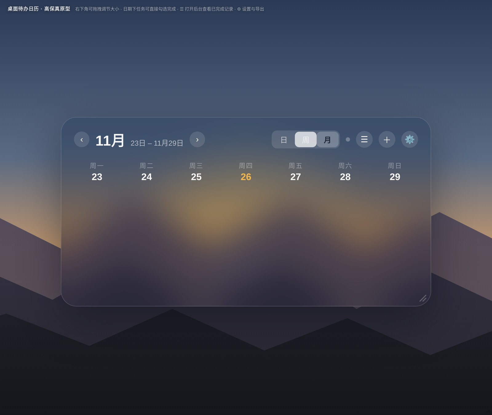
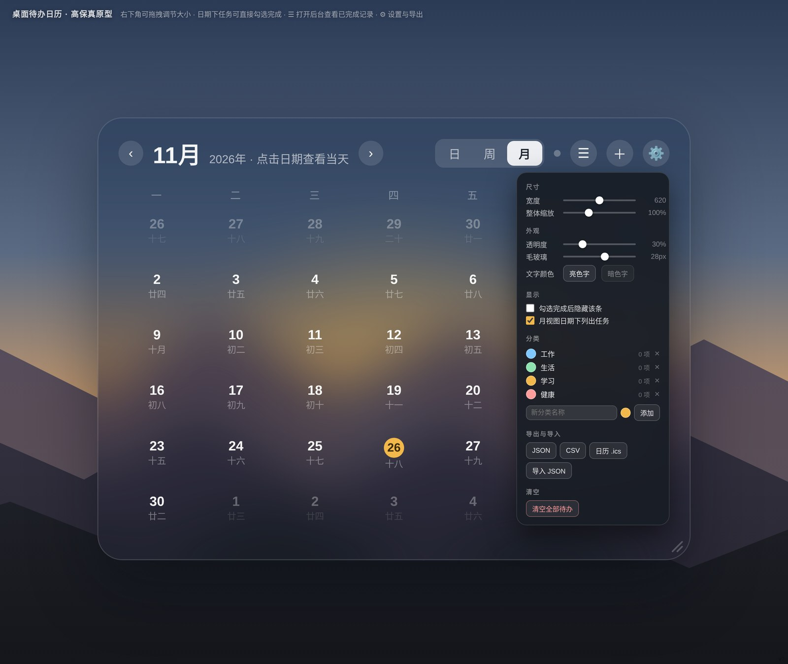
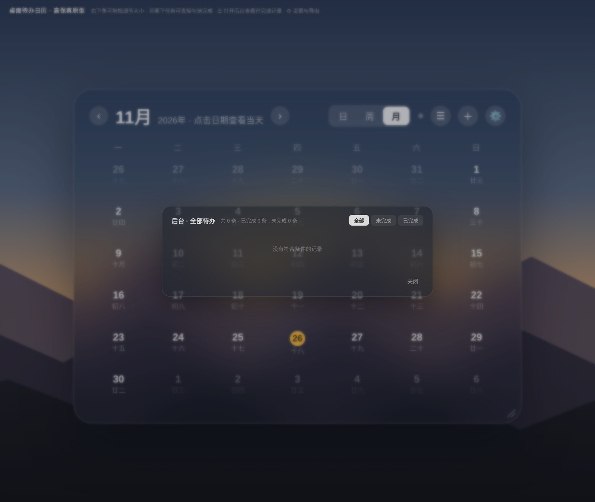

# DeskCal

适用于 Windows 11 和 macOS 的日历与待办小组件。Windows 1.0.6 使用独立无边框挂件，macOS 版显示在桌面层。

macOS 外壳用 Swift 的 `NSPanel` + `WKWebView`，Windows 外壳用 WPF + WebView2，两者共用单文件 `index.html`。所以视觉和交互全在一个网页里，想改什么改什么。

数据存在本机 `localStorage`，不需要后端，不联网，没有账号。开箱即用。



## Windows 11 移植版

Windows 1.0.6 沿用标准 WPF WebView2 窗口。首次显示和恢复时，DWM 暂时遮蔽主窗口，待日历、窗口尺寸和 WPF 绘制就绪后再显示。窗口可见期间由 Windows 合成 Desktop Acrylic，设置中可以开关毛玻璃。关闭系统透明效果或某些远程会话时，背景可能呈现纯色。

挂件首次打开在主屏工作区右下角，拖顶部短横条移动。它使用正常可激活的顶层工具窗口，隐藏任务栏与 Alt+Tab 入口，保留通知区域的日历图标。其他应用获得焦点后可覆盖它；点击挂件时它仍能正常获得焦点。没有 WorkerW / Progman 嵌入、鼠标穿透、强制置底或始终置顶。

### 打开程序

先从托盘退出旧版，将 x64 压缩包完整解压到新文件夹，再双击 `DeskCal.exe`。右下角显示「DeskCal 1.0.6」。点顶部右侧 × 隐藏，左键单击托盘图标显示或隐藏。右键托盘可显示、隐藏、刷新、查看输入诊断，或选择「退出 DeskCal」结束进程。运行需要 .NET Framework 4.8 或更高版本和 [Microsoft Edge WebView2 Evergreen 运行时](https://developer.microsoft.com/microsoft-edge/webview2/#download-section)。

### 待办提醒

给未完成待办填写日期和时间。到点时 Windows 版会显示「DeskCal 提醒」小窗（时间、标题）并播放一次 Windows 系统提示音。同批提醒合用一个小窗和一次声音。隐藏到托盘后继续计时，退出则停止。重新启动或睡眠唤醒后，最近 90 分钟内错过的提醒会补发一次。

待办仍保存在原来的 localStorage，使用原有日期、时间和完成状态。已有未完成且带时间的待办也参与调度。WebView2 用户目录里只另存已提醒的去重记录，键由待办 ID、日期和时间生成；改到新时间后按新时间提醒。

### 空白日历与旧版迁移

新用户首次启动时待办为零，1.0.2 和 1.0.3 用户原有待办与设置直接沿用。更早版本中的记录仅在「设置 → 从旧版选择待办」勾选并迁移后才加入个人清单。数据位于 `%LOCALAPPDATA%\DeskCal\WebView2`，升级无需删除此目录。

### 自行构建

在仓库根目录、装有 .NET SDK 的终端运行：

```powershell
dotnet build Windows/DeskCal.csproj -c Release
.\Windows\bin\Release\net48\DeskCal.exe
```

首次构建会从 NuGet 还原依赖。分发时复制整个 `Windows/bin/Release/net48/` 目录，包括 `web`、`runtimes`、DLL 和许可证。

### 操作及输入排查

- 左右箭头翻页，点月视图的日期进入当天；用日、周、月按钮切换视图。
- 点「＋」创建待办，点圆圈勾选或恢复。在日视图或「☰ 全部待办」里点「编辑」，可改内容、日期、时间和分类。
- 「设置」可输入宽高后点「应用」，或拖动日历右下角调整。宽高按 100% 缩放计，通常最小 380 × 300，最大为当前窗口所在显示器的工作区。数字与拖动结果随现有设置保存。
- 拖动顶部短横条，在工作区左右边缘约 24 DIP 内松手即可吸附，只留下约 16 × 96 DIP 的把手。点把手展开，点顶部箭头收起。展开后拖离边缘可以解除吸附。按 × 或从托盘选择隐藏会一并隐藏边缘把手。
- 若遇到输入问题，点几次日期和按钮，再从托盘选择「查看输入诊断」。计数表示本次加载后网页收到的按下与点击次数。
- Windows 原生输入回归脚本位于 `Windows/tests/input_smoke.py`。在已解锁的专用 Windows 测试桌面，退出其他 DeskCal 实例，安装 Python 3.10+ 后，执行 `python Windows/tests/input_smoke.py Windows/bin/Release/net48/DeskCal.exe`。脚本以临时 WebView2 配置运行，通过 Windows 鼠标和键盘操作实际控件，覆盖焦点切换、滚动、关闭隐藏、托盘回调、重启持久化及真实定时提醒。独立测试程序在临时目录运行发布版入口并读取页面状态。

## 特性

1. **月 / 周 / 日三种视图**，翻页切换，点日期直接下钻到当天。
2. **点圆圈或整行都能勾选完成**，命中区域做得大，不用瞄准。
3. **农历与节日**，走系统 `Intl` 的 Chinese calendar，节气节日自动显示。
4. **分类可自建**，四个默认分类带颜色，改名、改色、增删都行。
5. **外观可调**，宽度、整体缩放、背景透明度、毛玻璃强度、文字明暗。
6. **数据带得走也带得回来**，导出 JSON、CSV，或者日历 `.ics` 直接导入系统日历；导出过的 JSON 还能再导回本组件。
7. **完全本地**，断网全功能可用，不产生任何网络请求。
8. **不占 Dock**，以 `.accessory` 模式运行，只在菜单栏留一个日历图标。

## macOS 快速开始

需要 macOS 12 或更高，以及 Xcode 命令行工具。

```bash
xcode-select --install     # 只装过一次就不用再装
cd DeskCalApp
bash build_app.sh
open DeskCal.app
```

首次打开，主屏右下角的桌面上会出现一个磨砂圆角卡片。

自己编译的 App 没有 Apple 签名，如果双击提示「已损坏」或没有反应，执行下面这行去掉隔离标记再打开：

```bash
xattr -d com.apple.quarantine DeskCal.app
```

## 使用

| 操作 | 说明 |
|---|---|
| 切视图 | 顶部的「日 / 周 / 月」三段按钮 |
| 翻页 | 标题两侧的 ‹ › 按钮，按当前视图翻一天、一周或一月 |
| 勾选完成 | 点任务左侧的圆圈，或者点整行 |
| 新增待办 | 右侧的 ＋ 按钮 |
| 全部待办 | 右侧的 ☰ 按钮，可按全部 / 未完成 / 已完成筛选 |
| 设置 | 右侧的 ⚙ 按钮，调尺寸、外观、显示、分类、导出与导入、清空 |
| 移动位置 | 按住卡片主体拖动 |
| 改大小 | 拖右下角的斜纹把手 |
| 退出 | 菜单栏的日历图标，点退出 |

### 周视图



### 设置

尺寸、透明度、毛玻璃、文字明暗都是即时生效的，拖完即所见。



### 全部待办



## 可选：跨机器同步

默认不做，数据就在本机。如果你有多台 Mac 想让它们在同一个清单上工作，`sync-server/` 里有一套 FastAPI + SQLite 的同步后端，两个接口 `GET /state` 与 `PUT /state`，按条目 `updatedAt` 合并。

**这部分请务必读完再部署。** 它没有用户体系，做错了等于把待办清单挂到公网上让人随便读写。要点三条：

1. **在反向代理层按来源放行。** nginx 给接口路径加白名单，只放行 `127.0.0.1` 和你自己的出口 IP，其余 `deny all`。这是唯一真正有效的一层。
2. **或者干脆不对外暴露。** 后端只监听 `127.0.0.1`，需要同步时走 SSH 隧道把端口转到本机。出口 IP 不固定就用这种。
3. **不要只加一个 token 就发到公网。** 组件要能同步就得从服务器加载页面，而那个页面是公开的，写在页面里的 token 谁看源码都能拿到，只能挡住随手扫描。

细节见 [sync-server/README.md](sync-server/README.md)。

## 常见问题

**界面能显示，但点了没反应。**
外壳的 `panel.becomesKeyOnlyIfNeeded` 必须是 `false`。设成 `true` 时窗口不会成为 key window，WKWebView 就不派发 JS 的 `click` 事件，界面看起来完全正常，只是点不动。

**界面是黑的，只有一块深色背景。**
用 container 包住 webview 之后忘了 `container.addSubview(webView)`。属性赋值不会把视图加进层级。

**卡片四个角是黑色方块。**
container 上开了 `masksToBounds = true`。圆角加裁剪会把 webview 渲染成纯黑，保持默认的 `false` 就行。

**改了 `index.html` 但界面没变。**
WKWebView 缓存很激进。外壳加载时在 URL 上带 `_ts` 时间戳并强制忽略本地缓存，所以重新跑一遍 `bash build_app.sh` 再打开就行。菜单栏图标里的「刷新组件」也能强制重载。

**换电脑怎么把清单搬过去。**
本机模式的数据存在 `localStorage` 里，不进任何云。要搬就先用「设置 → 导出与导入 → JSON」导出，在新机器上装好之后用「导入 JSON」选那份文件。导入按「内容 + 日期」判重，同一份文件导两次不会出现副本。

**退出之后再打开，待办全没了。**
这是外壳选了非持久数据仓的老毛病，现已修正：从 App 包内以 `file://` 加载时用可落盘的数据仓，只有从远程 http 加载才用非持久仓。如果你手上的版本还会丢，重新跑一次 `bash build_app.sh` 覆盖掉旧 App 即可。

**卡片被窗口挡住的部分点不到。**
这是设计如此。组件在桌面层，和桌面图标同一层，被普通窗口盖住的区域不接收点击。空出桌面就能点。

**能直接下载一个 `.app` 吗？**
不能。没有 Apple 开发者账号就无法公证，未公证的 App 分发出去别人打不开。所以这里是源码加一键构建脚本，各自本地编译。

## 目录结构

```
DeskCal/
├── index.html                  # 组件界面，全部视觉与交互都在这里
├── Windows/                    # Windows 11 外壳和 .NET 构建项目
├── DeskCalApp/
│   ├── App.swift               # 原生外壳：NSPanel + WKWebView
│   └── build_app.sh            # 编译 + 打包 + 自签
├── sync-server/                # 可选：跨机器同步后端
│   ├── app.py                  # FastAPI + SQLite
│   ├── deskcal.service         # systemd 托管配置
│   └── README.md
├── docs/                       # 截图与截图生成脚本
└── LICENSE
```

界面截图由 `docs/make-screenshots.py` 生成，它用无头 Chrome 真实渲染 `index.html`，不是手绘效果图。改了界面想更新截图：

```bash
python3 docs/make-screenshots.py
```

## 许可

[PolyForm Noncommercial License 1.0.0](https://polyformproject.org/licenses/noncommercial/1.0.0)。

个人使用、学习、研究、修改、分享都可以。不得用于商业目的，不得上架应用商店，不得对外售卖，不得用于交付给客户的商业项目。要商用请联系作者。
